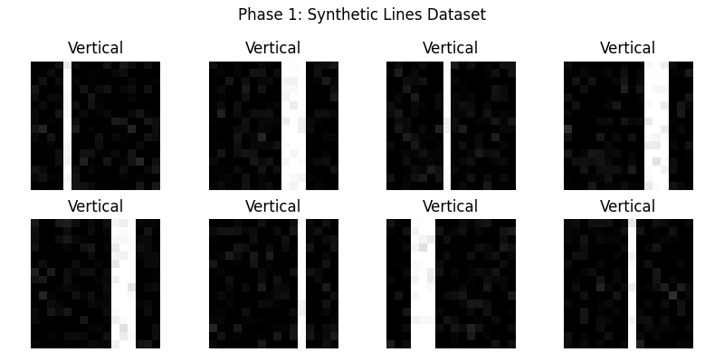
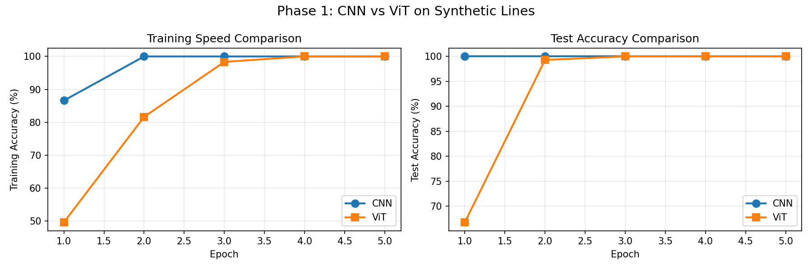
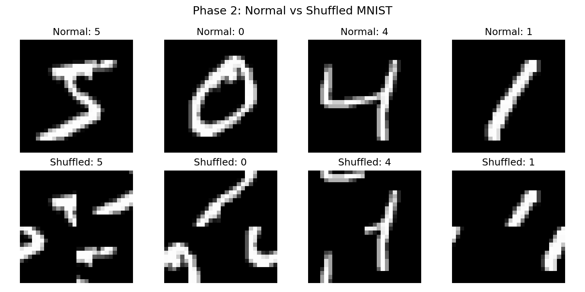
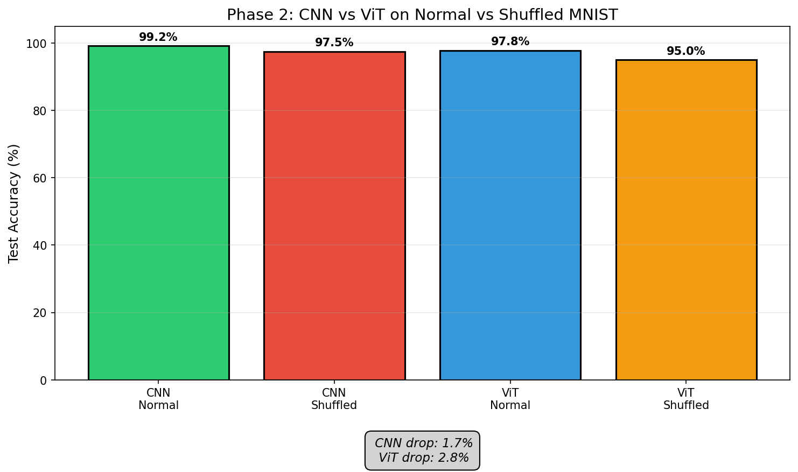
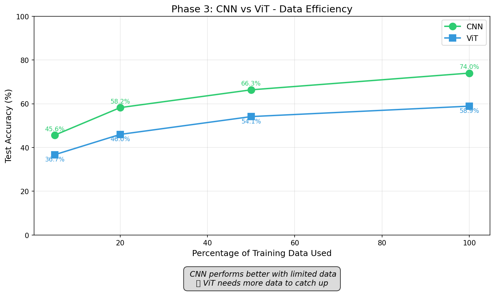
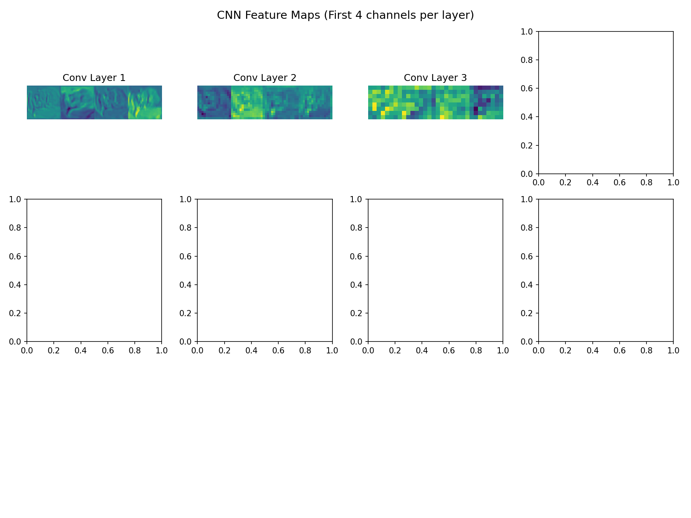
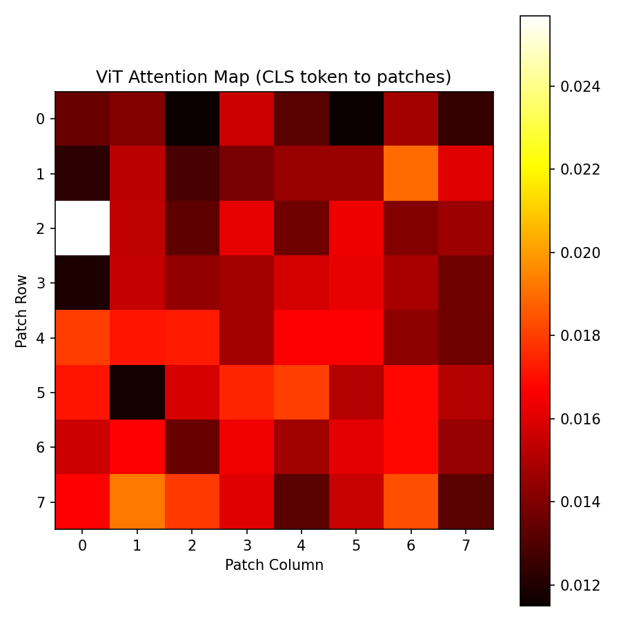
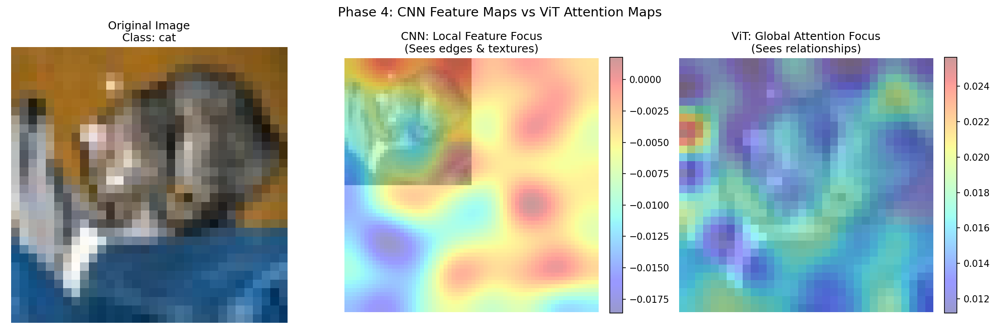

# CNN vs Vision Transformer: A Complete Learning Lab

> 4 hands-on experiments that reveal why CNNs and Vision Transformers work differently — with visual proof.

[](https://www.python.org/)
[](https://pytorch.org/)
[](LICENSE)

---

## Overview

I built this lab because I was tired of reading papers that said "Transformers are better" without showing me why.

This repository contains 4 hands-on experiments that compare CNNs and Vision Transformers side-by-side on the same problems.

| Phase | Experiment | What You'll Learn |
|-------|-----------|-------------------|
| 1 | Synthetic Lines | CNNs have built-in spatial intelligence |
| 2 | Shuffled MNIST | CNNs depend on local structure |
| 3 | Data Efficiency | ViTs are data-hungry |
| 4 | Visualization | See what each model pays attention to |

---

## Phase 1: Synthetic Lines

**The Setup:** 16x16 images with vertical or horizontal lines.

**What Happens:**
- CNN: 100% accuracy in 2 epochs
- ViT: 100% accuracy in 4 epochs

**The Insight:** CNNs have built-in spatial common sense (inductive bias). ViTs have to learn everything from scratch.


*Figure 1a: Sample images from the synthetic lines dataset*


*Figure 1b: CNN learns faster than ViT*

**Terminal Output:**
```
Phase 1 Complete!
CNN Final Test Accuracy: 100.00%
ViT Final Test Accuracy: 100.00%
```

---

## Phase 2: Shuffled MNIST

**The Setup:** MNIST digits cut into 4 quadrants and randomly shuffled.

**What Happens:**
- CNN: 99.19% to 97.48% (Drop: 1.71%)
- ViT: 97.80% to 95.05% (Drop: 2.75%)

**The Insight:** CNN relies on local spatial structure. ViT looks at global relationships.


*Figure 2a: Normal vs shuffled MNIST samples*


*Figure 2b: CNN vs ViT accuracy on normal vs shuffled MNIST*

**Terminal Output:**
```
Results Summary:
   CNN on Normal MNIST:     99.19%
   CNN on Shuffled MNIST:   97.48%
   ViT on Normal MNIST:     97.80%
   ViT on Shuffled MNIST:   95.05%
```

---

## Phase 3: Data Efficiency

**The Setup:** Training on 5%, 20%, 50%, and 100% of CIFAR-10.

**What Happens:**
- CNN stays strong even with 5% data
- ViT struggles without massive data

**The Insight:** Got small data? Use CNN. Got millions of images? ViT might be worth it.


*Figure 3: CNN is more data-efficient than ViT*

**Results Table:**

| Data Size | CNN Accuracy | ViT Accuracy |
|-----------|--------------|--------------|
| 5% | 45.64% | 36.69% |
| 20% | 58.22% | 45.97% |
| 50% | 66.35% | 54.12% |
| 100% | 74.00% | 58.89% |

**Terminal Output:**
```
Phase 3 Complete!
Final Accuracies:
   5% Data: CNN = 45.64%, ViT = 36.69%
   20% Data: CNN = 58.22%, ViT = 45.97%
   50% Data: CNN = 66.35%, ViT = 54.12%
   100% Data: CNN = 74.00%, ViT = 58.89%
```

---

## Phase 4: Visualization

**The Setup:** Peeking inside both models to see what they "look at."

**What You See:**
- CNN: Edge detectors, texture maps, local features
- ViT: Object relationships, global context

**The Insight:** CNN sees the trees. ViT sees the forest.


*Figure 4a: CNN feature maps from different layers (edges to shapes to objects)*


*Figure 4b: ViT attention map showing which patches the model focuses on*


*Figure 4c: Side-by-side comparison - CNN (local) vs ViT (global)*

---

## Results Summary

| Metric | CNN | ViT | Winner |
|--------|-----|-----|--------|
| Learning Speed | Fast | Slow | CNN |
| Data Efficiency | High | Low | CNN |
| Spatial Understanding | Local | Global | ViT |
| Simple Patterns | Great | Struggles | CNN |
| Complex Relationships | Struggles | Great | ViT |

---

## Quick Start

### Prerequisites

- Python 3.8+
- PyTorch 1.9+

### Installation

```bash
# Clone the repository
git clone https://github.com/yourusername/cnn-vs-vit-learning-lab.git
cd cnn-vs-vit-learning-lab

# Install dependencies
pip install -r requirements.txt

# Run all experiments
python run_all_experiments.py
```

### Run Individual Phases

```bash
# Phase 1: Synthetic Lines (2 minutes)
python practice-experiments/phase1_synthetic_lines.py

# Phase 2: Shuffled MNIST (10 minutes)
python practice-experiments/phase2_shuffled_mnist.py

# Phase 3: Data Efficiency (20-25 minutes)
python practice-experiments/phase3_data_efficiency.py

# Phase 4: Visualization (5 minutes)
python practice-experiments/phase4_visualization.py
```

---

## Key Takeaways

### When to Use CNN

- Small datasets (less than 50,000 images)
- Simple patterns and textures
- Fast training needed
- Limited computational resources

### When to Use ViT

- Large datasets (more than 1,000,000 images)
- Complex relationships between objects
- Global context understanding
- Access to powerful GPUs

---

## Built With

- PyTorch - Deep learning framework
- TorchVision - Image datasets
- Matplotlib - Visualizations
- NumPy - Numerical computations

---

## License

This project is open source and available under the MIT License.

---

Built with PyTorch. Because understanding beats memorizing.